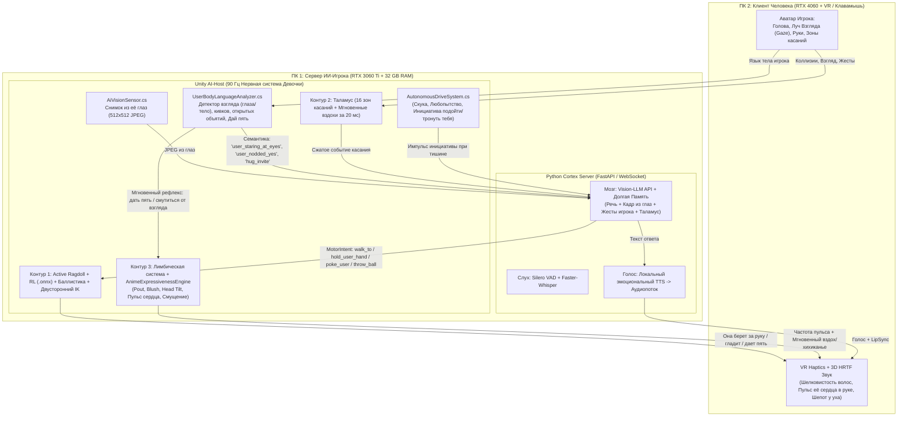

# План реализации: AI-Chan Embodied VR (Полная нейрофизическая архитектура + Живой UX аниме-тянки)

## 1. Утвержденная конфигурация и распределение по двум ПК

| Узел / Компонент | Где крутится | Что именно делает |
| :--- | :--- | :--- |
| **ПК №1: Сервер (`RTX 3060 Ti + 32 GB RAM`)** | **Unity AI-Host (Игрок-ИИ)** + **`brain-server` (Python)** | 1. Крутит комнату и авторитетную физику (`Active Ragdoll`, мяч, предметы). 2. **Рендерит мир из глаз девочки (`AiVisionSensor.cs`)** и отправляет снимки в Vision-LLM. 3. Анализирует твой взгляд и язык тела (`UserBodyLanguageAnalyzer.cs`). 4. Крутит RL-нейросеть ходьбы (`.onnx`), Таламус, Автономные драйвы инициативы, STT и локальный TTS. |
| **ПК №2: Клиент (`Ноутбук RTX 4060 + WiVRn VR`)** | **Unity Human-Client (Игрок-Человек)** | 1. Подключается по LAN к серверу как в мультиплеерную игру. 2. Выдает 90 FPS в VR-шлеме (или на Клава+Мыши), бинауральный 3D-звук (HRTF) и **процедурную тактильную отдачу (VR Haptics)**, когда она касается тебя. 3. Передает координаты твоей головы, глаз/взгляда, рук и микрофона. |
| **Скилл управления Unity** | `.agents/skills/unity-bridge/` (`unity_ctl.py` $\leftrightarrow$ `AgentBridgeServer.cs`) | Дает агенту полный доступ к редактору Unity без ручных действий пользователя (замена `.vrm`, пересборка костей и коллайдеров, настройка камер, Play Mode, скриншоты). |

---

## 2. Что делает её ЖИВОЙ аниме-тянкой, а не куклой (Двусторонний UX и Инициатива)

Чтобы она ощущалась настоящей живой аниме-девочкой, взаимодействие должно работать **в обе стороны** — не только ты её трогаешь, но и **она сама проявляет инициативу, читает твои жесты без слов и сама прикасается к тебе**.

### 2.1. Чтение твоего взгляда и языка тела без слов (`UserBodyLanguageAnalyzer.cs`)
Девочка непрерывно (в 90 Гц) анализирует геометрию твоего аватара (головы и рук) + проверяет кадры через `AiVisionSensor`:
1. **Детектор зрительного контакта и того, КУДА ты пялишься (`Gaze Raycast`):**
   * Из твоей камеры/шлема идет луч взгляда. Она всегда знает, куда ты смотришь.
   * **Долгий взгляд глаза в глаза с близкого расстояния ($< 0.6\text{ м}$):** через 1.5 секунды у неё начинают бегать зрачки, растет `Blush`, она смущенно наклоняет голову, отводит взгляд в сторону и тихо спрашивает, почему ты так смотришь.
   * **Если ты пялишься не в глаза (например, на грудь/ноги):** луч взгляда попадает в соответствующий коллайдер $\to$ мгновенный триггер смущения/возмущения, она прикрывается руками и делает замечание!
   * **Совместное внимание (Joint Attention):** если ты повернул голову и смотришь на какой-то предмет в комнате, она прослеживает твой взгляд, поворачивает голову туда же и комментирует его.
2. **Понимание твоих невербальных жестов (без микрофона):**
   * **Кивок головой (`Nod Yes`) / Показ несогласия (`Shake No`):** анализируется угловая скорость твоей головы по питчу/рысканью. Она может спросить: *«Будешь еще играть?»* — ты просто молча киваешь в VR, и она понимает!
   * **Приглашающие жесты руками:**
     * Ты раскрыл руки в стороны (`OpenArmsHugInvite`) $\to$ она видит приглашение к объятиям и (если `Trust` высокий) сама подходит и прижимается к тебе.
     * Ты поднял раскрытую ладонь (`HighFiveOffer`) $\to$ её Спинной мозг через IK хлопает своей ладонью по твоей («Дай пять!»).
     * Ты протянул руку ладонью вверх (`HandHoldOffer`) $\to$ она кладет свою ладонь в твою и сжимает пальцы.

### 2.2. Её физическая инициатива к тебе (`BidirectionalTouchController.cs` + VR Haptics)
На твоем аватаре тоже есть целевые точки (`UserHead`, `UserCheek_L/R`, `UserHand_L/R`, `UserShoulder_L/R`, `UserChest`). Она сама может инициировать физический контакт:
* **Взять тебя за руку и повести за собой:** хватает твою VR-руку и тянет к баскетбольной площадке или дивану.
* **Погладить тебя по голове / потрепать волосы:** когда ты устал или вы сидите рядом, она сама тянется к `UserHead`.
* **Дразнящие аниме-реакции:** легонько ткнуть тебя пальцем в щеку/грудь, ущипнуть или слегка толкнуть в плечо, когда смеется или дуется.
* **Спрятаться за тебя / уткнуться лбом в плечо:** когда смущена, устала или пугается.
* **Тактильная отдача в твоих руках (`HapticFeedbackSynthesizer.cs`):**
  * Когда ты гладишь её волосы или щеку — твои VR-контроллеры дают мягкую шелковистую микро-вибрацию, зависящую от скорости скольжения твоей руки.
  * Когда ты держишь её за руку или обнимаешь — в контроллеры передается ритм её **сердцебиения (BPM зависит от `Arousal` и `Blush` — когда она волнуется, ты буквально рукой чувствуешь, как у неё колотится сердце!)**.

### 2.3. Фирменная «Аниме-пластика» и мгновенные голосовые вздохи (`AnimeExpressivenessEngine.cs`)
1. **Мгновенный паралингвистический голос (0 мс задержки, до ответа LLM!):**
   Когда ты неожиданно тронул её за щеку, поймал за талию или кинул в неё мяч, человек не молчит полсекунды в тишине, пока формулирует предложение.
   * У неё есть локальный банк коротких эмоциональных звуков её же тембром (**вздохи, «Ай!», «Э-э?!», «Мм~», хихиканье, смущенное бурчание, дыхание после бега**).
   * Спинной мозг включает нужный вздох **через 20 миллисекунд** после касания, а через 400 мс этот вздох бесшовно переходит в полноценную фразу от LLM + TTS!
2. **Бинауральный 3D-звук и шепот на ухо (HRTF Spatial Audio):**
   * Источник звука привязан ровно к кости её губ (`Lips`).
   * Если она подходит к тебе вплотную (< 0.35 м) и наклоняется к твоему уху, TTS автоматически переключается на мягкий интимный тембр/шепот, и ты слышишь её дыхание прямо у конкретного уха.
3. **Аниме-язык тела (Процедурные модификаторы позы поверх Ragdoll):**
   * **Наклон головы (`Anime Head Tilt`):** когда она слушает твой голос или удивлена, голова плавно наклоняется набок на 12–15°.
   * **Надутые щечки (`Pout` BlendShape + скрещенные руки / руки в боки):** когда она обиделась или ты её передразниваешь.
   * **Смущенный фиджетинг (`Shy Fidget`):** когда `Blush > 0.6`, она сводит пальцы перед собой, переступает с носка на пятку и прячет глаза.
   * **Разница в росте (`Height Look-Up`):** её рост ~155–160 см, поэтому когда она подходит близко, она естественно поднимает подбородок и смотрит на тебя снизу вверх.

### 2.4. Свобода воли и система внутренних драйвов (`AutonomousDriveSystem.cs`)
Она никогда не замирает как NPC в ожидании твоей команды. Каждые несколько секунд работает цикл внутренней мотивации:
* **`Boredom` (Скука):** если ты молчишь 15 секунд, она не стоит столбом — она может сама пойти подобрать мяч, начать набивать его, сесть, потянуться, подойти к тебе вплотную и помахать рукой перед твоим лицом: *«Эй, ты там уснул в шлеме?»*
* **`Affection / Proximity Drive`:** в зависимости от настроения она сама выбирает комфортную дистанцию до тебя (то ходит хвостиком за тобой по комнате, то держит дистанцию, если вредничает).

---

## 3. Полная схема взаимодействия 4 контуров и двусторонней связи

---

## 4. Предлагаемые файлы для создания в `/home/kiriewka/all/ai-chan`

### Компонент А: Скилл управления Unity и скрипты (`.agents/skills/unity-bridge/` & `scripts/`)
* #### [NEW] [SKILL.md](file:///home/kiriewka/all/ai-chan/.agents/skills/unity-bridge/SKILL.md)
  Полный регламент управления Unity Editor для агента.
* #### [NEW] [unity_ctl.py](file:///home/kiriewka/all/ai-chan/.agents/skills/unity-bridge/scripts/unity_ctl.py)
  CLI-утилита для команд редактору по HTTP (`UNITY_BRIDGE_URL`).
* #### [NEW] [fetch_default_vrm.py](file:///home/kiriewka/all/ai-chan/scripts/fetch_default_vrm.py)
  Авто-загрузчик открытой `.vrm` модели аниме-девочки.

---

### Компонент Б: Редакторская автоматизация (`unity-project/Assets/Editor/`)
* #### [NEW] [AgentBridgeServer.cs](file:///home/kiriewka/all/ai-chan/unity-project/Assets/Editor/AgentBridgeServer.cs)
  HTTP JSON-RPC сервер внутри редактора Unity (`[InitializeOnLoad]`).
* #### [NEW] [VrmRagdollAutoRigger.cs](file:///home/kiriewka/all/ai-chan/unity-project/Assets/Editor/VrmRagdollAutoRigger.cs)
  Авто-сборка `Active Ragdoll`, 16 зон Таламуса, глазной камеры `AiVisionSensor` и контроллеров аниме-экспрессии на любой `.vrm` модели.
* #### [NEW] [SandboxSceneBuilder.cs](file:///home/kiriewka/all/ai-chan/unity-project/Assets/Editor/SandboxSceneBuilder.cs)
  Авто-сборщик сцены, комнаты, баскетбольного кольца, мяча, девочки и аватара игрока.

---

### Компонент В: Нервная система, Зрение и Живой Аниме-UX (`unity-project/Assets/Scripts/`)
* #### [NEW] [NeuralBusContracts.cs](file:///home/kiriewka/all/ai-chan/unity-project/Assets/Scripts/Core/NeuralBusContracts.cs)
  Контракты всех 4 контуров, включая жесты игрока (`UserBodyGesture`), направления взгляда (`GazeTarget`) и двусторонние моторные намерения (`hold_user_hand`, `pat_user_head`, `poke_user_cheek`, `hug_user`, `high_five`).
* #### [NEW] [AiVisionSensor.cs](file:///home/kiriewka/all/ai-chan/unity-project/Assets/Scripts/Vision/AiVisionSensor.cs)
  Камера между глазными костями VRM, рендерящая то, что видит сама девочка (`512x512 JPEG`), с отсечением геометрии её собственного лица/челки.
* #### [NEW] [UserBodyLanguageAnalyzer.cs](file:///home/kiriewka/all/ai-chan/unity-project/Assets/Scripts/Perception/UserBodyLanguageAnalyzer.cs)
  Анализатор игрока в реальном времени (90 Гц):
  * Отслеживает луч взгляда игрока (`GazeRay`): фиксирует зрительный контакт глаза-в-глаза, отвод взгляда или разглядывание частей тела.
  * Распознает кивки (`NodYes`), качание головой (`ShakeNo`), раскрытые для объятий руки (`HugInvite`), поднятую ладонь (`HighFiveOffer`), протянутую руку (`HandHoldOffer`) и резкие взмахи.
* #### [NEW] [SomatosensoryThalamus.cs](file:///home/kiriewka/all/ai-chan/unity-project/Assets/Scripts/Thalamus/SomatosensoryThalamus.cs) & [BodyZoneSensor.cs](file:///home/kiriewka/all/ai-chan/unity-project/Assets/Scripts/Thalamus/BodyZoneSensor.cs)
  Классификация прикосновений за 200 мс (`Stroke`, `Pat`, `Poke`, `Slap`, `GrabHold`, `Pull`, `Pinch`) + мгновенный запуск коротких голосовых вздохов/реакций за 20 мс.
* #### [NEW] [LimbicSystem.cs](file:///home/kiriewka/all/ai-chan/unity-project/Assets/Scripts/Limbic/LimbicSystem.cs) & [AnimeExpressivenessEngine.cs](file:///home/kiriewka/all/ai-chan/unity-project/Assets/Scripts/Limbic/AnimeExpressivenessEngine.cs)
  Эмоции (`Valence`, `Arousal`, `Blush`, `Trust`, `HeartRateBpm`), аниме-мимика (`Pout` надутые щеки, звезда/сердечки в глазах, полуприкрытые глаза, румянец), наклоны головы (`Head Tilt`), смущенное переминание пальцев (`Shy Fidget`) и дыхание.
* #### [NEW] [AutonomousDriveSystem.cs](file:///home/kiriewka/all/ai-chan/unity-project/Assets/Scripts/Limbic/AutonomousDriveSystem.cs)
  Генератор собственной инициативы и свободы воли: шкалы скуки, любопытства и желания тактильного контакта (сама подходит к тебе, заглядывает в лицо, берет за руку или зовет играть, когда ты молчишь).
* #### [NEW] [ActiveRagdollController.cs](file:///home/kiriewka/all/ai-chan/unity-project/Assets/Scripts/Spinal/ActiveRagdollController.cs) & [BidirectionalTouchController.cs](file:///home/kiriewka/all/ai-chan/unity-project/Assets/Scripts/Spinal/BidirectionalTouchController.cs)
  Физические мышцы, RL-баланс/ходьба (`.onnx`) и двухручный IK, позволяющий ей не только ловить баскетбольный мяч, но и **самой прикасаться к твоим рукам, плечам, голове и щекам**.
* #### [NEW] [BallisticPredictor.cs](file:///home/kiriewka/all/ai-chan/unity-project/Assets/Scripts/Spinal/BallisticPredictor.cs)
  Математика перехвата и бросков предметов.
* #### [NEW] [HapticAndBinauralAudio.cs](file:///home/kiriewka/all/ai-chan/unity-project/Assets/Scripts/Interaction/HapticAndBinauralAudio.cs)
  Процедурная вибрация VR-контроллеров (текстура скольжения по волосам, передача стука её сердца в твою ладонь при удержании руки/объятиях) + 3D HRTF позиционирование голоса и шепота.
* #### [NEW] [HybridInteractionRig.cs](file:///home/kiriewka/all/ai-chan/unity-project/Assets/Scripts/Interaction/HybridInteractionRig.cs) & [NetworkRoomSync.cs](file:///home/kiriewka/all/ai-chan/unity-project/Assets/Scripts/Network/NetworkRoomSync.cs)
  Гибридный игрок (VR + Клавамышь) и сетевая синхронизация между Сервером-ИИ и Клиентом-Человеком.
* #### [NEW] [CortexWebSocketClient.cs](file:///home/kiriewka/all/ai-chan/unity-project/Assets/Scripts/Cortex/CortexWebSocketClient.cs)
  Связь с Python-сервером Коры.

---

### Компонент Г: Сервер Коры с Vision-LLM и Памятью (`brain-server/`) + RL (`rl-training/`)
* #### [NEW] [cortex_server.py](file:///home/kiriewka/all/ai-chan/brain-server/cortex_server.py)
  Мультимодальный мозг (Vision + Тактильность + Язык тела игрока + Долговременная память + Автономная инициатива + Локальный TTS).
* #### [NEW] [HumanoidBalanceAgent.cs](file:///home/kiriewka/all/ai-chan/unity-project/Assets/Scripts/RL/HumanoidBalanceAgent.cs) & [ppo_locomotion.yaml](file:///home/kiriewka/all/ai-chan/rl-training/ppo_locomotion.yaml)
  Обучение RL-ходьбы и баланса.

---

## 5. План проверки (Verification Plan)

1. Автотесты Python-сервера, классификатора касаний Таламуса, детектора языка тела игрока (кивки, взгляд, жесты) и баллистики.
2. Сборка сцены через скилл `unity-bridge`, проверка снимков из глаз девочки (`AiEyeCamera`) и прогон двусторонних взаимодействий (ты её гладишь $\leftrightarrow$ она сама берет тебя за руку / реагирует на долгий взгляд в глаза).
